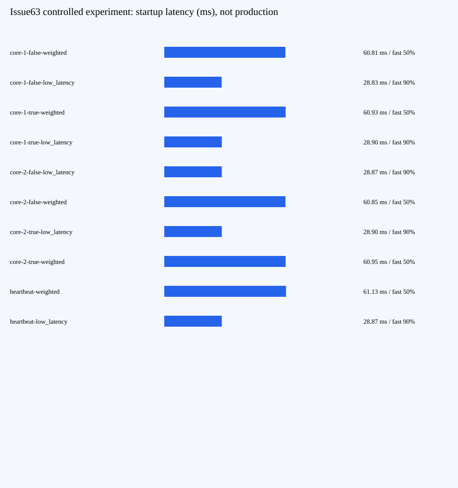

# Issue63 受控实验实测（研发，不是独立QA）

预注册v2未修改；2480/2480样本、2240核心+160心跳+80长尾，全部请求成功、1attempt、1charge，无断言失败。供应商/生产性能 Not Run。

|场景/轮/模式|权重快端|低延迟快端|权重指标均值ms|低延迟指标均值ms|改善|互换后新快端|
|---|---:|---:|---:|---:|---:|---:|
|core/1/普通|50%|90%|60.809|28.827|52.59%|90%|
|core/1/SSE|50%|90%|60.926|28.903|52.56%|90%|
|core/2/普通|50%|90%|60.854|28.872|52.56%|90%|
|core/2/SSE|50%|90%|60.949|28.895|52.59%|90%|
|heartbeat/1/SSE|50%|90%|61.134|28.874|52.77%|不适用|

每cell学习40和互换适应40单独保留在summary.json；完整分布含均值/p50/p95、成功率、attempt数、窗口时间和上下游首输出/完整耗时在JSONL，不只展示稳态。稳定快端90%意味着约10%正常探索慢端；p95仍约100ms，不保证p95改善。所有核心cell在40次内出现基于新评分的新快端选择。

长尾双方首输出均20ms，而完整时间有20/200ms尾部：以下报告完整耗时，不能当作首输出收益。

|cell|评分均值ms|完整均值ms|完整p50|完整p95|
|---|---:|---:|---:|---:|
|tail-false-weighted|20.887|158.491|72.125|251.412|
|tail-false-low_latency|20.906|178.618|245.523|256.241|
|tail-true-weighted|20.885|159.703|74.080|252.098|
|tail-true-low_latency|20.963|152.019|76.206|255.404|

图文件和逐请求样本由Run实际文件归档；此相对路径不是远端已下载证明。固定测试/QA应自行核完整入口及其候选版本。

## 实测组织成本

cell墙钟含正常代理、SQLite/记账、同ID诊断读取和样本编码；overhead=(cell墙钟−上游完整耗时累计)/请求数，不等于网络纯开销。无浏览器/编译/其他实验并跑。

|cell|请求数|墙钟秒|均摊overhead ms|
|---|---:|---:|---:|
|core-1-false-weighted|280|23.432|18.221|
|core-1-false-low_latency|280|15.755|19.961|
|core-1-true-weighted|280|24.505|21.828|
|core-1-true-low_latency|280|16.781|23.403|
|core-2-false-low_latency|280|17.099|24.756|
|core-2-false-weighted|280|25.751|26.482|
|core-2-true-low_latency|280|18.046|27.925|
|core-2-true-weighted|280|26.791|29.999|
|heartbeat-weighted|80|7.682|30.479|
|heartbeat-low_latency|80|5.279|30.370|
|tail-false-weighted|20|3.246|31.742|
|tail-false-low_latency|20|3.646|33.734|
|tail-true-weighted|20|3.270|32.780|
|tail-true-low_latency|20|3.114|33.932|

runner总194.999秒；cells合194.397秒，安装/配置/初始化/汇总等约0.602秒；外部go run命令墙钟195.802秒含编译启动。预算用195.802与236秒取大。原始summary在最终输出前读取时间，日志END在写文件之后读取时间，相差2ms是观测位置差，不覆盖原件。
