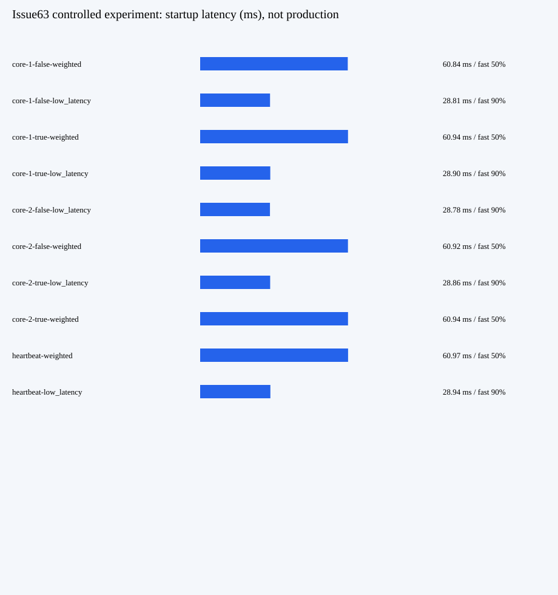

# Issue63 / Issue65 静态结果看板与证据索引

本页是GitHub可读的静态附件，未部署在线站点。当前同版产品QA通过、执行7委托正式确认完成；草稿PR与远端核验仍待固定publisher。

普通响应体首字节和SSE首有效输出增量分开测量；均值约61→29ms、快端50%→90%，p95约101ms基本不变。不是供应商TTFT、生产SLA或线上费用收益。完整矩阵、用户操作、失败修复及限制见[交付报告](report.md)。

## 仓库内可审阅材料

- [49件真实差异清单](../development/publication-files.json)：相对产品基线7709fe…，包含原路径.trellis契约。
- [171件源码清单](../development/source-manifest.json)：路径/bytes/SHA及6316…全源码摘要，不是源码dump。
- [接续准备记录](../development/implementation.md)：保留原Pipeline来源，非重新实现。
- 原Run冻结[plan-v2](../../ba434da8039cca16f6829481112e3d68/plan-v2.md)、[experiment-v2](../../ba434da8039cca16f6829481112e3d68/experiment-v2.md)、[首次No-Go](../../ba434da8039cca16f6829481112e3d68/qa-first-no-go.md)、[最终QA](../../ba434da8039cca16f6829481112e3d68/qa-recheck.md)保留原文。
- 最终QA与PR正文由固定publisher原文复制到docs/harness/run-*；本页不虚构尚未生成的发布路径。

## 受控Run归档证据

下列是归档定位符，不是GitHub仓库文件下载链接；不公开原始大日志、私有主机路径或凭据。已在QA6归档的96件由其manifest 95项加manifest自身构成；本报告实际逐size/SHA重核这95项。所有原始请求JSONL、16张安全截图及17件旧原件具体路径，见下方完整逐文件索引。本节点只重新核材料，没有重跑产品测试或重新下载旧全量归档。

| 归档文件 | bytes | SHA256 |
| --- | ---: | --- |
| `harness-output/qa.md` | 17664 | `488d880684869608de5ce24a2aaf07b48d727de50c36a6b0e2b728c21ab8f6fb` |
| `harness-output/qa-history-review/artifact-manifest.json` | 19608 | `7a1d9ac49d53174848fc11fa5b6f8ca6f0335a9ff65de8dccc56fca6a91a668b` |
| `harness-output/qa-history-review/result.json` | 7475 | `8fa70c2f6a0f47bd5201f7d8df4a468790f537b5d96e6610c34d480cc5fc532d` |
| `harness-output/qa-current/gate-verify.log` | 1133897 | `12bb512d518da7e5a3feb86d86af9443ef1258dda286faf437b7f705c8284c50` |
| `harness-output/qa-current/gate-state.json` | 4580 | `b3cbb416359c8a01c9f4fb9e92ad8413d0362f5c30e9639dba54897dfb7e74b1` |
| `workflow-output/e11d82e7f5d28afd80f64477377f1c63/command-3.log` | 1177020 | `b72250062fb68152890bc018d374a4c1bbd282f975b9a80182bda0dc0351df82` |
| `harness-output/qa-current/audit.json` | 91915 | `bcfae37db908d164c3a056222dca953903a3af2aa6ce84ec9712b1ec7a372652` |
| `harness-output/qa-current/gate-experiment/summary.json` | 26159 | `abb2a29c32bec15aa237058317799c320ed12d21f32155571f549b2634fbab70` |
| `harness-output/qa-current/independent-go.log` | 72282 | `953bc25ce6d41c4951b87717100d2bd5016abfbba452c38b1e1f3e1216493ac3` |
| `harness-output/qa-current/safety-weighted.log` | 4377 | `81a08a7e7eac0462cadadaef4114b24a393eb39274297592e1f5fa81536e858f` |
| `harness-output/qa-current/independent-ui.log` | 4726 | `fc644aa9b7e9e55d99be5445f67c1b1b057e206664be8216c5bf444fad25d5c6` |
| `harness-output/qa-current/independent-ui-recheck.log` | 4093 | `680e6f2e1076a6af32cde1f4a3769b9bc6f2f59d47393d52c9c0e4aeb5df2af9` |
| `harness-output/qa-original-recheck/original-late.log` | 1014 | `4fa7b354bee9783c7da5ccd0dae7cce6b62f7e7fbad1282fb2efc6e6ec737f0a` |
| `harness-output/qa-original-recheck/original-watermark.log` | 1029 | `3535d65a7f64f1b9dd3463352538905841d94901744c24efc2c87220e7460eb3` |
| `harness-output/qa-original-recheck/prior-qa-evidence-insufficient.md` | 15873 | `653d6c4849532506c0c5501d99305c68264c11a39a2dbc81a5ef77b68b8c2d9c` |
| `harness-output/qa-history-review/prior-qa4-supplement-no-go.md` | 14358 | `56d12a93291c8d691ef57784e13f52a83a9bf0caae2467b9e9b5c63704e6a69b` |
| `harness-output/qa-current/archive-mappings.json` | 7638 | `37cca876b5c9aca34e7884fa019d77a5d399f028583bb407dd2bb5c13e9e0641` |
| `harness-output/qa-original-recheck/prior-report-relocations.json` | 649 | `49214dbaf70b7d7e95f9854a442a547b607a2e990bb415d330ba5a7a9b531046` |
| `harness-output/qa-history-review/report-relocations.json` | 750 | `246bed9d50ae1476fef7c1ff0aeb73de43c718e561683c0e29f53801287e6fa3` |

## QA留存完整逐文件索引

历史manifest中的No-Go等文字与路径按原映射保留，当前结论以最终qa.md为准。源码原件以.go.txt或.go.txt.artifact归档，不参与编译；.artifact后缀不改变原字节，不执行或解包。

| 归档文件 | bytes | SHA256 |
| --- | ---: | --- |
| `docs/workflow/runs/e11d82e7f5d28afd80f64477377f1c63/development/implementation.md` | 7213 | `bda7136d3a30c1373d19f7d514e0b743a6afd7ee3cf55d6439ffc64fb495d34b` |
| `docs/workflow/runs/e11d82e7f5d28afd80f64477377f1c63/development/publication-files.json` | 8894 | `af141d27e1d5240cf4d53e45cefb08f7dad26a3673f54afaa9480d79f7af786c` |
| `docs/workflow/runs/e11d82e7f5d28afd80f64477377f1c63/development/source-manifest.json` | 29448 | `191290f9f9daff929c92580ae09923bb1c806c1b316c19c4d25d6128bd385088` |
| `docs/workflow/runs/e11d82e7f5d28afd80f64477377f1c63/qa/qa.md` | 17664 | `488d880684869608de5ce24a2aaf07b48d727de50c36a6b0e2b728c21ab8f6fb` |
| `harness-output/imports/ba434da8039cca16f6829481112e3d68/9/harness-output/issue63-qa-recheck/manifest.json.artifact` | 40645 | `ff9daf032fdac8b9140c133e130256ef0748dae1cb663edca45bb48145ade205` |
| `harness-output/imports/ba434da8039cca16f6829481112e3d68/9/harness-output/issue63-qa-recheck/original-negative-recheck.log.artifact` | 1135 | `eeed5699236a311722f3d842fd200d1a142f02ff374b6e47fd6d507f7507fa27` |
| `harness-output/imports/ba434da8039cca16f6829481112e3d68/9/harness-output/issue63-qa-recheck/retention-check.json.artifact` | 827 | `8224ea028a33b7d02c54c3f2ecbc02d99b09675503bc3e7c591e46087b26499a` |
| `harness-output/imports/ba434da8039cca16f6829481112e3d68/9/harness-output/issue63-qa/late-after-failure.log.artifact` | 514 | `0f46327e231233eb5ae05b5789e749a753fcf902442387880d88e74025e674c8` |
| `harness-output/imports/ba434da8039cca16f6829481112e3d68/9/harness-output/issue63-qa/late-after-failure_test.go.txt.artifact` | 1705 | `8f12c6134590eded5fcd24af544b97505c85e79a827ed437c10d2b9b771aafe2` |
| `harness-output/imports/ba434da8039cca16f6829481112e3d68/9/harness-output/issue63-qa/manifest.json.artifact` | 14185 | `1e32e91512bf672335e6a6a8cdb95287a356bc47a6f8a3bb52b1a1d056f58a82` |
| `harness-output/imports/ba434da8039cca16f6829481112e3d68/9/harness-output/issue63-qa/overlay.json.artifact` | 144 | `2183eb48999dc9f348e88a5fb67949f39ec3a3961e3c83e68c49b3713ef08f15` |
| `harness-output/imports/ba434da8039cca16f6829481112e3d68/9/harness-output/issue63-qa/sequence-watermark.log.artifact` | 553 | `972f522dd43e6670795269c77c623739454af7cf524c854aeda7c3758e1a6dbe` |
| `harness-output/imports/ba434da8039cca16f6829481112e3d68/9/harness-output/issue63-qa/sequence-watermark_test.go.txt.artifact` | 2293 | `c4e7dc07e51233e1453b051894270a88129f61624d08208d174f736bd65b09d5` |
| `harness-output/imports/ba434da8039cca16f6829481112e3d68/9/harness-output/issue63-qa/watermark-overlay.json.artifact` | 149 | `3039858395e9d94c36ad8e6b5a57cb20f5556b6b0cbbd64f4cf5b7a74f7017cc` |
| `harness-output/imports/ba434da8039cca16f6829481112e3d68/9/harness-output/issue63-rework-1/manifest.json.artifact` | 14863 | `dcdcd2f5676dd6709dbb295a2ae569091d1d8d63e335198d2e7fb0b258266215` |
| `harness-output/imports/ba434da8039cca16f6829481112e3d68/9/harness-output/issue63-rework-1/source-manifest.json.artifact` | 5927 | `5ccf160aa56e9ea2a849ed82fa1854397a75a9c07c536fe4645b3c283b4ce2fd` |
| `harness-output/imports/ba434da8039cca16f6829481112e3d68/9/harness-output/issue63-rework-2/handoff-manifest.json.artifact` | 28194 | `5d5ecbf36d5cd17bdbb30e92b442187ff05af658def09075e6db2898f975582c` |
| `harness-output/imports/ba434da8039cca16f6829481112e3d68/9/harness-output/issue63-rework-2/source-manifest.json.artifact` | 29907 | `910eee7e1a29987caa4624e845fd5f0ca4d3a586d07ca3c77c26a66971809a32` |
| `harness-output/imports/ba434da8039cca16f6829481112e3d68/9/test-results/verification/20261025T135914Z-1386142975/state.json.artifact` | 4135 | `c267a248e9b8fcedfc2af2e47257be47bde2cd3c10ba949d9837a5256600eb87` |
| `harness-output/imports/ba434da8039cca16f6829481112e3d68/9/test-results/verification/20261025T135914Z-1386142975/verify.log.artifact` | 1069973 | `7d5029d2addda20056a3a3d8cbaf3ff62f1054e33dab729772fdcd3b918e08fe` |
| `harness-output/imports/ba434da8039cca16f6829481112e3d68/9/workflow-output/ba434da8039cca16f6829481112e3d68/command-6.log.artifact` | 1074864 | `225937af5544c5c6014e2891642dd324d3cd798451e172cc79ba92adb7c143b5` |
| `harness-output/issue63-qa/late-after-failure_test.go.txt` | 1705 | `8f12c6134590eded5fcd24af544b97505c85e79a827ed437c10d2b9b771aafe2` |
| `harness-output/issue63-qa/overlay.json` | 144 | `2183eb48999dc9f348e88a5fb67949f39ec3a3961e3c83e68c49b3713ef08f15` |
| `harness-output/issue63-qa/sequence-watermark_test.go.txt` | 2293 | `c4e7dc07e51233e1453b051894270a88129f61624d08208d174f736bd65b09d5` |
| `harness-output/issue63-qa/watermark-overlay.json` | 149 | `3039858395e9d94c36ad8e6b5a57cb20f5556b6b0cbbd64f4cf5b7a74f7017cc` |
| `harness-output/qa-current/archive-mappings.json` | 7638 | `37cca876b5c9aca34e7884fa019d77a5d399f028583bb407dd2bb5c13e9e0641` |
| `harness-output/qa-current/artifact-manifest.json` | 10698 | `08f6312caad477ba674aa36b3eb90874185c19043c81a0d9beaae7cacf55bae7` |
| `harness-output/qa-current/audit.json` | 91915 | `bcfae37db908d164c3a056222dca953903a3af2aa6ce84ec9712b1ec7a372652` |
| `harness-output/qa-current/audit.log` | 433 | `31fe232d3ad61477fb3e02ec960ead869b9e104ba2ee8638ce309e47e0839e98` |
| `harness-output/qa-current/audit.mjs` | 8064 | `5a3d4afffd9394cb90a941050e42c68053d41c5889b0e2452c70dadb78e09c2d` |
| `harness-output/qa-current/commands.md` | 5182 | `2e093aa581969fe5d05e723a1018b5521836d26a42b653e64562ce9ac8303b97` |
| `harness-output/qa-current/gate-experiment/comparison.svg` | 2153 | `562f63bf499f0394c802610c0711a01789d63eec1f54577eea4ad2b5d8ae7d51` |
| `harness-output/qa-current/gate-experiment/core-1-false-low_latency.jsonl` | 589075 | `872ae1207587a1c6b608cac7289d4646d628191e2664722fba5e642291eb5f38` |
| `harness-output/qa-current/gate-experiment/core-1-false-weighted.jsonl` | 584247 | `52af521d179e235047e787261399ebb15616c5ce1232672a45e48ab7d2134cc8` |
| `harness-output/qa-current/gate-experiment/core-1-true-low_latency.jsonl` | 583184 | `773fc64dc8d7161b64294b3710c7204bb28fc39bd8d2a4ae6bc8f124176b93c6` |
| `harness-output/qa-current/gate-experiment/core-1-true-weighted.jsonl` | 578388 | `13c039482f108423ab4a9b82e03a96faa5785c35e6163d686c4245a69a0033d1` |
| `harness-output/qa-current/gate-experiment/core-2-false-low_latency.jsonl` | 589008 | `47d757a4bc844125d29a19e0e6cb25f75c9139dcdb7313c19a7bc2212e374ddb` |
| `harness-output/qa-current/gate-experiment/core-2-false-weighted.jsonl` | 584329 | `8cacf57bb4b1f81ba416efd8691b55f9b815829295b707a37c2d005673e149e5` |
| `harness-output/qa-current/gate-experiment/core-2-true-low_latency.jsonl` | 583244 | `cc88e03033c0185a2a2664333136df4dcd500da862cad1eb063de2cc97a9e87a` |
| `harness-output/qa-current/gate-experiment/core-2-true-weighted.jsonl` | 578364 | `24d8995f93a94bcd3c25f63e6f3e66910798001bb0145579b133b0d6b8ec7991` |
| `harness-output/qa-current/gate-experiment/heartbeat-low_latency.jsonl` | 166305 | `b53b9604f69026fb1e3dd2adfa0352a188bbc9dcdc7b9f8aca161e5983b91e97` |
| `harness-output/qa-current/gate-experiment/heartbeat-weighted.jsonl` | 164833 | `d6830c93e03863fdb2ee840e57f558944827f38a93ab482204057bfc103fc21b` |
| `harness-output/qa-current/gate-experiment/summary.json` | 26159 | `abb2a29c32bec15aa237058317799c320ed12d21f32155571f549b2634fbab70` |
| `harness-output/qa-current/gate-experiment/tail-false-low_latency.jsonl` | 41626 | `fa550e1f10ec018cf075054df6180d86316807f33ba0a9b71bd2b8da70c9aad1` |
| `harness-output/qa-current/gate-experiment/tail-false-weighted.jsonl` | 41263 | `cb5be2a2cca277b0344ad35e24f1fd9f9deb480a97cd2acdb2fa4a60e7b2115f` |
| `harness-output/qa-current/gate-experiment/tail-true-low_latency.jsonl` | 41219 | `6cbc2d83dc800cb24801b3006051f3da87ceadd41ce1615a9ceb153627adc6da` |
| `harness-output/qa-current/gate-experiment/tail-true-weighted.jsonl` | 40849 | `753850fbe59f4bbf983e2c71fbab88243cd56bb603fe6eab3fd08f662b084140` |
| `harness-output/qa-current/gate-state.json` | 4580 | `b3cbb416359c8a01c9f4fb9e92ad8413d0362f5c30e9639dba54897dfb7e74b1` |
| `harness-output/qa-current/gate-verify.log` | 1133897 | `12bb512d518da7e5a3feb86d86af9443ef1258dda286faf437b7f705c8284c50` |
| `harness-output/qa-current/independent-go.log` | 72282 | `953bc25ce6d41c4951b87717100d2bd5016abfbba452c38b1e1f3e1216493ac3` |
| `harness-output/qa-current/independent-ui-recheck.log` | 4093 | `680e6f2e1076a6af32cde1f4a3769b9bc6f2f59d47393d52c9c0e4aeb5df2af9` |
| `harness-output/qa-current/independent-ui.log` | 4726 | `fc644aa9b7e9e55d99be5445f67c1b1b057e206664be8216c5bf444fad25d5c6` |
| `harness-output/qa-current/late-negative.go.txt` | 2621 | `311f903e050a236a6257ff1279edd901ac285f38f5d0fbd18a519378dc7b3bf9` |
| `harness-output/qa-current/lineage-missing-evidence.log` | 126 | `1f4d48460398a6866c04c0534ca90d32fa64310edbf3736f6e546749bbff839f` |
| `harness-output/qa-current/overlay.json` | 123 | `4549525412bc32780ac65d23d1ee2db5f5ab1ca5638318ac5fbb443fd0a8d483` |
| `harness-output/qa-current/playwright-loader.mjs` | 250 | `d4c60f8b4883f5552ea8ee200cf3ba1a1fed15c88496b19bb21ad101098bdb6d` |
| `harness-output/qa-current/reconstructed-negatives.log` | 1025 | `43eb77c5ef3a54ec25dee4cc564594b664e8d4a233f9c0efc912349f33b46cb5` |
| `harness-output/qa-current/result.json` | 689 | `829ca584c638bf0d0b5980dfaaedc632850f0e32e430419d3c9a31e34c534502` |
| `harness-output/qa-current/safety-weighted.log` | 4377 | `81a08a7e7eac0462cadadaef4114b24a393eb39274297592e1f5fa81536e858f` |
| `harness-output/qa-current/source-after.log` | 486 | `e66ec54b5e14ea0ad381f0cae69bfdb32b3d24cf08171104ac779bfa4190514b` |
| `harness-output/qa-current/ui/latency-ui-1280-ordinary-diagnostic.png` | 45969 | `455986f2494afc4d6e608bc0d531a5fc2e6f9935561e153a325d463e69bce665` |
| `harness-output/qa-current/ui/latency-ui-1280-ordinary-observation.png` | 52685 | `d2c5ffdb5e9f9e4d031816d91d4914be074dbeb50dd85983b9df9d6419264d03` |
| `harness-output/qa-current/ui/latency-ui-1280-ordinary-selection.png` | 40270 | `cc2982a837746983586bbf747ebb1d21af38fdbc075d055f9ec3c88a0b13eaca` |
| `harness-output/qa-current/ui/latency-ui-1280-restart.png` | 59256 | `5deff2423f31dd58e5d14c4f470da77892b6b85e09af7a50e7c1a5406122dcad` |
| `harness-output/qa-current/ui/latency-ui-1280-sse-diagnostic.png` | 45914 | `80abbb4640b45fa39e7e52664ffb4fbea4a7a5d3ea75decf5419a9c7424cc29f` |
| `harness-output/qa-current/ui/latency-ui-1280-sse-observation.png` | 52854 | `e82080da7f02e466e829c779f8f0c3f95086cbbe01b2c478d8096ea270069ce7` |
| `harness-output/qa-current/ui/latency-ui-1280-sse-selection.png` | 40882 | `f6d1654239f45b889c8303383301571f52b1917247cf97731212dec6073c1655` |
| `harness-output/qa-current/ui/latency-ui-1280-strategy.png` | 59351 | `84679adb5924624972d84b9802143476597419a9097f107049debd7528fb3e5b` |
| `harness-output/qa-current/ui/latency-ui-1280.json` | 1659 | `bbc6fdf7c6d944f6345f0c8aa45f5cac24e470c76569548c49e2a581977e7559` |
| `harness-output/qa-current/ui/latency-ui-390-ordinary-diagnostic.png` | 42618 | `92742240d0d2d29d03b56e97202c93b38d35072c74b7c4d319ba486daaff985d` |
| `harness-output/qa-current/ui/latency-ui-390-ordinary-observation.png` | 48178 | `cb0678714ba55d4f3670619bdfe28ff90529726e5ab033e2066d67ac42baffd6` |
| `harness-output/qa-current/ui/latency-ui-390-ordinary-selection.png` | 37842 | `8bbe347e69ad4d61e3c9f0e6d2f637cb80fae8baed1a85d85175adb282bc75ae` |
| `harness-output/qa-current/ui/latency-ui-390-restart.png` | 53177 | `539994bf99510a81c41988747ae52abd0a556490813369e61ac01f205b3e4312` |
| `harness-output/qa-current/ui/latency-ui-390-sse-diagnostic.png` | 42966 | `733cb9e64cadb46128b7e40480fbe7be93848e038870176d50e7f9fefb03a559` |
| `harness-output/qa-current/ui/latency-ui-390-sse-observation.png` | 48682 | `bab293f15f20fac53d9f9ddb30e1016730c3a1ae94b02329bc34c1db87179c92` |
| `harness-output/qa-current/ui/latency-ui-390-sse-selection.png` | 38436 | `3b7b132df6381bcc581ed5e402bb9f5ed5fc8c17f551584e7ec100af8736626c` |
| `harness-output/qa-current/ui/latency-ui-390-strategy.png` | 52883 | `066f9423bd08e0196da596a0ebdcfe508c4dd4e4d66fb8c96bdc2fb154a43024` |
| `harness-output/qa-current/ui/latency-ui-390.json` | 1648 | `8440cd5c183203ce45a67cb3b22830a4bc3e5ebb461c591eeb3ed6f09733a4d7` |
| `harness-output/qa-history-review/commands.md` | 2478 | `8ab04cb9a771129802c2855bc0732ab1480b58e736e10ec4465e7593b56fcd7f` |
| `harness-output/qa-history-review/finalize-report.mjs` | 15959 | `4979a7eab6a8d45ce10f7c2554120545d81616ea7a8cf1b050c725d170c38131` |
| `harness-output/qa-history-review/prior-qa4-supplement-no-go.md` | 14358 | `56d12a93291c8d691ef57784e13f52a83a9bf0caae2467b9e9b5c63704e6a69b` |
| `harness-output/qa-history-review/report-relocations.json` | 750 | `246bed9d50ae1476fef7c1ff0aeb73de43c718e561683c0e29f53801287e6fa3` |
| `harness-output/qa-history-review/result.json` | 7475 | `8fa70c2f6a0f47bd5201f7d8df4a468790f537b5d96e6610c34d480cc5fc532d` |
| `harness-output/qa-history-review/verify-history.log` | 1681 | `1654fe3136a5679019be05dcfb7028653fa86184c9f6455d5190b5dd885f1d75` |
| `harness-output/qa-history-review/verify-history.mjs` | 10437 | `df50f9001e1e7d43e99895c7376d5cbbffd2d0815dee8dd99bfc86483cd57633` |
| `harness-output/qa-original-recheck/artifact-manifest.json` | 13058 | `5f2185ae6e0944dadce96338c5208ca4985a8fd2e91b939b93e0e2157cfbbe7b` |
| `harness-output/qa-original-recheck/final-source.log` | 486 | `c5525ab26a78f02bbfc6d3a7585d1a37a65314dab97fc40653e57dd87fbf9ee9` |
| `harness-output/qa-original-recheck/intake.json` | 1270 | `d6f7480f3cd2548c307f4f689943d94e1106ec1343fd0d8c4c7e78e51d9f84a8` |
| `harness-output/qa-original-recheck/original-late.log` | 1014 | `4fa7b354bee9783c7da5ccd0dae7cce6b62f7e7fbad1282fb2efc6e6ec737f0a` |
| `harness-output/qa-original-recheck/original-watermark.log` | 1029 | `3535d65a7f64f1b9dd3463352538905841d94901744c24efc2c87220e7460eb3` |
| `harness-output/qa-original-recheck/prior-qa-evidence-insufficient.md` | 15873 | `653d6c4849532506c0c5501d99305c68264c11a39a2dbc81a5ef77b68b8c2d9c` |
| `harness-output/qa-original-recheck/prior-report-relocations.json` | 649 | `49214dbaf70b7d7e95f9854a442a547b607a2e990bb415d330ba5a7a9b531046` |
| `harness-output/qa-original-recheck/result.json` | 816 | `f126b64ff77dcc911449e1b763d1a63a3360731ab3cbfe46509efe2be4a887d1` |
| `harness-output/qa.md` | 17664 | `488d880684869608de5ce24a2aaf07b48d727de50c36a6b0e2b728c21ab8f6fb` |
| `workflow-output/e11d82e7f5d28afd80f64477377f1c63/command-3.log` | 1177020 | `b72250062fb68152890bc018d374a4c1bbd282f975b9a80182bda0dc0351df82` |

## 审阅边界

QA4两个局部UI并发合计8请求，第二轮覆盖首轮同名截图，现存16张最终匹配图；raw trace隐私Not Run。QA6仅历史补件核验，17件入站为人工恢复，不能称自动跨Run恢复。旧红、当前绿分列，不用旧失败替代当前结果。原Run释放后671件重下载为Owner上游确认；本轮真实PR/release/全新下载待完成。
